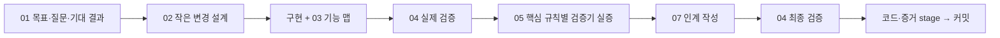

# 단계별 스킬 사용 안내

이 문서는 사람이 키트의 동작을 이해하면서 에이전트에게 다음 일을 맡기기 위한 안내서다. 설치와 전체 작업 순서는 [readme.kit.md](readme.kit.md), 실제 에이전트 진입 규칙은 [AGENTS.md](AGENTS.md)에 있다.

스킬은 **에이전트가 읽고 따르는 작업 지침**이다. 이름을 부른다고 코드가 자동 완성되거나 검사가 저절로 생기는 실행 프로그램은 아니다. 번호는 어느 단계의 도구인지 알아보기 위한 표시다. 매 작업마다 01부터 07까지 전부 거칠 필요는 없다.

## 번호로 먼저 보기

| 단계 | 스킬 | 쉽게 말하면 | 주로 남기는 것 |
|---|---|---|---|
| 01 시작·질문 | [01-fde-workflow](.agents/skills/01-fde-workflow/SKILL.md) | 무엇을 풀어야 하는지, 누구에게 무엇을 물어야 하는지 정한다 | [docs/intent.md](docs/intent.md)의 요구·질문·답변·판단 |
| 02 이해·설계 | [02-design-change](.agents/skills/02-design-change/SKILL.md) | 코드가 어떻게 움직이고 어디를 바꿀지 찾는다 | 작업 분해·변경 범위·중요 설계 판단 |
| 03 기능 기억 | [03-feature-map](.agents/skills/03-feature-map/SKILL.md) | 사용자가 실제로 기능을 쓰는 길을 적는다 | [docs/features.md](docs/features.md) |
| 04 실제 검증 | [04-verify-app](.agents/skills/04-verify-app/SKILL.md) | 같은 상태·같은 방법으로 원하는 결과가 나오는지 확인한다 | verification/check와 .evidence/ |
| 05 검증기 실증 | [05-test-verifier](.agents/skills/05-test-verifier/SKILL.md) | 일부러 틀린 코드를 넣어 검사가 그 잘못을 잡는지 확인한다 | 결함별 patch·실패·복구 증거 |
| 06 실패 수정 | [06-debug-root-cause](.agents/skills/06-debug-root-cause/SKILL.md) | 왜 실패했는지 찾아 원인을 고친다 | 재현 입력·원인 위치·회귀 검사·수정 근거 |
| 07 인계·재개 | [07-handoff](.agents/skills/07-handoff/SKILL.md) | 다른 세션도 현재 상태에서 이어갈 수 있게 남긴다 | [docs/handoff.md](docs/handoff.md) |

구현은 실제 과제의 소스코드에서 한다. 어떤 언어·프레임워크·입력 파일을 쓸지는 실제 문제에 맞춰 정한다. 이 키트가 새 웹앱이나 예제 프로젝트를 무조건 만들도록 요구하지 않는다.

## 01 — 시작과 업무 질문 정리

**언제 쓰나:** 새 과제를 받았을 때, 요구가 바뀌었을 때, 또는 “이상하게 동작한다”는 말만 있고 기대 결과가 분명하지 않을 때다.

**무엇을 하나:** 실제 과제 README·안내·데이터·기존 코드를 읽고, 확인된 사실과 사용자가 원하는 결과와 아직 모르는 점을 나눈다. 누구의 어떤 업무를 도와야 하는지, 어떤 입력으로 무엇을 내야 하는지, 성공을 어떻게 판단할지 정리한다. 답에 따라 구현이나 검사가 달라지는 질문부터 만든다.

**입력 → 결과:** 과제 자료·사용자 요청·실제 관찰 → `docs/intent.md`에 근거가 연결된 요구, 기대 결과, 미결 질문, 답변과 변경 이유를 남긴다. 같은 요구 목록을 여러 파일에 따로 만들지 않는다.

**메신저에서는:** 사람에게 전달할 짧은 질문 초안을 만든다. 어떤 상황인지, 무엇이 미정인지, 답에 따라 무엇이 달라지는지를 붙인다. 화면 조작과 전송은 RULE과 제공 환경의 역할에 따른다. 자동 전송하거나 전달·답변이 확인되지 않았는데 완료로 표시하지 않는다. 일부만 답했다면 그 부분만 확정한다.

예를 들어 “같은 예약을 다시 보내면 어떻게 해야 하나요?”만 묻는 대신 다음처럼 정리한다.

> 같은 요청 ID로 예약을 두 번 보낼 수 있습니다. 두 번째 요청도 재고를 차감해야 하나요, 아니면 첫 예약 결과를 돌려줘야 하나요? 이 답에 따라 중복 처리와 검증 기준을 정하겠습니다.

기대 결과가 빠져 있으면 반드시 질문한다. 답을 기다리는 동안 파일 구조 조사처럼 그 답에 의존하지 않는 일은 할 수 있지만, 미답변을 임의의 정답으로 채우지 않는다. 업무 내용, 플랫폼 사용법, 접속 장애는 실제 환경에서 제공하는 담당 경로를 구분해 문의한다.

## 02 — 코드 이해와 변경 설계

**언제 쓰나:** 기존 코드가 낯설거나, 수정 영향이 넓거나, 일을 어떻게 나눌지 정해야 할 때다. 이미 위치와 방법이 분명한 단순 수정에 큰 설계 문서를 만들 필요는 없다.

**무엇을 하나:** 사용자의 진입점부터 입력 처리, 상태 변화, 저장·외부 효과, 최종 출력까지 따라간다. 현재 동작과 기대 동작을 구분하고 가장 작은 완결 기능으로 나눈다. 자료형·모듈의 책임·입력 검증·권한·재시도 같은 경계를 확인한다.

**입력 → 결과:** 확인된 요구·관련 소스·현재 실행 → 바꿀 위치, 영향받는 경로, 구현 순서, 중요한 판단을 정한다. 오래 유지할 결정과 근거는 `docs/intent.md`에 필요한 만큼 기록한다.

예를 들어 중복 예약 버그라면 CLI 전체를 새로 만들지 않는다. 요청 ID를 조회하는 위치와 재고 차감 위치를 찾아, 중복 여부를 확인한 뒤 한 번만 차감하도록 책임을 정한다.

**대신하지 않는 것:** 설계 설명만으로 코드가 안전하다고 증명하지 않는다. 실제 구현과 04 검증이 뒤따라야 한다.

## 03 — 기능 맵 만들기와 갱신

**언제 쓰나:** 처음 기능을 문서화할 때, 기능·사용법·제약·관련 소스 위치가 바뀔 때다.

**무엇을 하나:** 사용자가 얻으려는 결과를 기준으로 기능을 묶고, 실제 접근 방법을 찾는다. 목적·진입점·전제조건·초기 상태·입력 순서·기대 결과·상태 변화·관련 소스·검증 방법을 연결한다. 문서의 설명대로 실제 실행해 맞는지도 확인한다.

**입력 → 결과:** 실제 기능과 실행 경로 → `docs/features.md`를 만든다. UI의 버튼·DOM뿐 아니라 CLI 명령, API 요청, 파일 입력, 라이브러리 호출, 백그라운드 작업도 적을 수 있다. 필요한 항목은 문제에 맞춰 더한다.

예약 기능의 예시는 다음과 같다.

> 목적: 재고 예약. 초기 상태: 재고 5. 진입: 실제 예약 CLI. 입력: 요청 R1, 수량 3. 결과: 재고 2. R1 재요청 결과: 재고 2 유지. 관련 소스와 이를 확인하는 검사 명령·증거를 연결한다.

**대신하지 않는 것:** Python 생성기나 고정 JSON 표가 아니다. 모든 커밋에서 전체를 재작성하지 않는다. 기능이 바뀐 부분과 관련 검사만 함께 갱신한다. 설명을 고쳐 제품 버그를 숨기지 않는다.

## 04 — 실제로 실행하고 검증하기

**언제 쓰나:** 검증을 처음 만들거나 실행법이 달라질 때, 그리고 구현 한 단위를 마쳤을 때다.

**무엇을 하나:** 같은 초기 상태로 되돌리는 방법과 항상 같은 실행 명령을 정한다. 기대값은 요구사항에서 정하고, 실제 사용자 진입점의 결과·저장 상태·오류 후 상태·부수효과를 관찰한다. 준비 완료, 시간 제한, 자신이 만든 임시 상태와 프로세스 정리까지 실제 검사에 넣는다.

**입력 → 결과:** 확인된 기대값·앱 실행법 → 문제별 실제 명령을 `verification/check`에 작성하고 `./scripts/check`로 실행한다. 실행 절차는 `docs/features.md`, 입력·기대·실제 결과·실패·정리 근거는 `.evidence/`에 남긴다.

예약 예시에서는 매번 재고 5로 시작해 정상 예약 후 2가 되는지, 초과 예약을 거절하고 2를 보존하는지, 중복 요청이 추가 차감되지 않는지 확인한다. 단순히 “프로그램이 켜졌다”로 끝내지 않는다.

공통 스크립트는 다음 관계로 움직인다.

```text
./scripts/check
  → scripts/source-tree working으로 검사 전 소스 식별
  → verification/check로 실제 검사
  → scripts/source-tree working으로 검사 중 소스 변경 확인
  → .evidence에 output.log·result, latest 기록
```

**대신하지 않는 것:** 스킬이 앱 검사 코드를 자동으로 제공하지 않는다. 기본 `verification/check`는 미설정으로 실패한다. Git 트리는 ignored 입력·설치 의존성·외부 DB·환경을 모두 포함하지 않으므로 문제별로 고정하고 기록해야 한다.

## 05 — 검증기를 믿을 수 있는지 실증하기

**언제 쓰나:** 검증을 처음 구성했을 때, 핵심 업무 규칙이나 그 검증 방법을 바꿨을 때다. 04를 실행할 때마다 모든 결함 실험을 무조건 반복하라는 뜻은 아니다. 바뀐 계약과 검사에 필요한 실증을 다시 한다.

**무엇을 하나:** 모든 핵심 규칙을 목록으로 잡고, 하나씩 의미 있는 잘못을 넣는다. 같은 검증 명령이 해당 규칙의 위반 때문에 실패하는지 확인한다. 결함을 복구한 뒤 같은 절차로 통과하는지도 본다.

**입력 → 결과:** 핵심 규칙·정상 검사 → 각 규칙의 변형 patch, 입력, 실제 실패, 어떤 검사가 잡았는지, 복구 성공을 남긴다. `docs/intent.md`에서 해당 증거로 연결한다. 실험은 안전한 격리 복사본이나 복구 가능한 상태에서 한다.

예약 예시라면 중복 확인을 제거해 같은 요청이 재고를 두 번 차감하게 만든다. 검사가 재고 -1을 관찰하고 “기대 재고 2와 다르다”고 실패해야 한다. 다음에는 초과 예약 차단을 따로 깨서 그 검사를 실증한다. 매 변형은 정상 기준에서 하나씩 시작한다.

**04와의 차이:** 04는 현재 구현이 맞는지 검사한다. 05는 **틀린 구현이 와도 검사가 틀렸다고 말하는지** 검사한다. 구문 오류·시작 실패·검사 중 소스 해시 차이만으로 업무 규칙을 잡았다고 하지 않는다. 최종 작업 코드에는 의도적 결함을 남기지 않는다.

## 06 — 실패의 최초 원인 찾기

**언제 쓰나:** 04가 실패했는데 이유가 불분명하거나, 같은 오류를 여러 번 고치고 있거나, 기존 버그를 수정할 때다.

**무엇을 하나:** 동일한 입력과 초기 상태에서 재현한다. 앱 준비 문제인지, 검사 도구 문제인지, 문서가 낡았는지, 제품 로직 문제인지 구분한다. 실제 값과 코드 경로를 따라 결과가 처음 잘못된 지점을 찾고 그 원인을 수정한다. 같은 방법으로 수정 전 실패와 수정 후 성공을 확인한다.

**입력 → 결과:** 실패 로그·실제 상태·기대 결과 → 재현 입력, 원인 코드 위치, 수정 이유, 회귀 검사, 검증 결과와 남은 한계를 기록한다. 요구가 바뀐 게 아니라면 정답을 낮춰서 통과시키지 않는다.

중복 예약에서 재고가 -1이 됐다면 “음수면 0으로 보정”하기 전에 요청 ID 확인과 차감 순서를 본다. 중복 확인보다 차감이 먼저라면 그 순서를 고치고 재시도 검사를 남긴다.

**대신하지 않는 것:** 근거 없는 재시도, 예외 삼키기, 검사 삭제는 해결이 아니다. 실제로 반복되는 패턴이 확인됐을 때 좁은 검사·타입·스크립트로 예방한다.

## 07 — 다른 세션에 넘기고 다시 시작하기

**언제 쓰나:** 세션 전환·맥락 부족·중단·완료 때, 그리고 새 세션에서 이어받을 때다.

**무엇을 하나:** 목표와 마지막 변경, 확인한 직전 SHA, 미커밋 상태, 구조·자료형·저장 위치, 정확한 실행 명령, 검증 범위, 실패·미확인·남은 위험, 다음 행동 한 가지를 남긴다. 새 세션은 요약만 믿지 않고 실제 Git·증거·앱·환경을 확인한다.

**입력 → 결과:** 현재 실제 상태 → `docs/handoff.md`. 요구와 판단은 `docs/intent.md`, 기능과 실행 방법은 `docs/features.md`를 연결해 중복 작성을 줄인다.

예약 기능을 넘긴다면 “정상 예약·중복 요청 검사는 통과했고, 여러 프로세스가 동시에 요청하는 상황은 미검증이다. 다음은 제공 환경에서 동시 요청 요구를 확인한다”처럼 쓴다.

**순서가 중요하다:** 인계 문서는 마지막 04 검증 **전에** 작성한다. 증거는 `.evidence/latest`를 참조한다. 그 뒤 검증 → 코드·인계·증거 함께 스테이징 → 커밋한다. 자기 문서가 포함될 최종 커밋 SHA를 미리 쓰지 말고 완료 응답에 남긴다. 검증 불가이면 미검증·미커밋 상태를 그대로 적는다.

## 상황별로 이렇게 이어진다

아래 화살표는 필요한 판단의 이동이다. 번호를 쉘 명령처럼 실행하는 것이 아니다. `구현`은 실제 과제 소스 수정, `검증`의 실행 입구는 `./scripts/check`다.

### 처음 받은 문제를 끝까지 풀 때



처음 만든 검증은 05에서 핵심 규칙별 탐지 능력을 확인한다. 실증 중 드러난 제품·검사 결함은 06으로 원인을 고친다. 인계와 최종 커밋은 실제 통과한 상태를 기준으로 한다.

### 업무 요구가 모호해 메신저로 질문해야 할 때

```text
01 자료와 현재 동작 확인
 → 답에 따라 결과가 바뀌는 질문 초안
 → 사람이 제공된 경로로 전달
 → 확인된 답변 범위만 docs/intent.md에 반영
 → 남은 질문이 있으면 다시 01 / 확정되면 02로 진행
```

“재요청은 무시해 주세요”라고만 답했다면 ID가 같은 경우인지, 내용까지 같아야 하는지까지 자동 확정하지 않는다. 기다리는 동안 그 답과 무관한 입력 파일 조사 등은 계속할 수 있다.

### 위치와 기대가 이미 분명한 작은 수정일 때

```text
실제 요구·현재 상태 확인 → 작은 구현
 → 기능 설명이 바뀌면 03 → 04 검증 → 코드·증거 stage → 커밋
```

단순 수정에 02의 별도 설계나 05의 전수 실험을 형식적으로 붙이지 않는다. 다만 핵심 로직·검사 방법이 바뀌었다면 관련 05 실증을 수행한다. 세션을 끝내면 커밋 전에 07 인계와 최종 04 검증을 추가한다.

### 검사가 실패하거나 기존 버그를 고칠 때

```text
기대 결과가 모호하면 01
 → 06 같은 입력에서 실패 재현·원인 확인
 → 필요하면 02 영향 확인 → 구현
 → 바뀐 설명은 03 → 04 검증
 → 핵심 규칙·검사가 바뀌었으면 관련 05 실증
 → 정상 상태 재검증 → 코드·증거 stage → 커밋
```

실패 증거를 먼저 남긴다. 같은 오류를 여러 번 추측해서 고치지 말고 실제로 최초 값이 잘못되는 지점을 좁힌다.

### 새 세션이 작업을 이어받을 때

```text
07 인계 + 실제 Git·증거 확인
 → docs/intent.md·docs/features.md와 실제 실행법 확인
 → 04 같은 초기 상태·같은 방법으로 현재 환경 재검증
 → 목표가 모호하면 01 / 다음 작은 작업이 확정됐으면 구현 계속
```

## 실제 실행 명령과 스킬을 구분하기

| 항목 | 실행되는 일 |
|---|---|
| 스킬의 SKILL.md 읽기 | 에이전트가 해당 단계의 판단 기준과 작업 순서를 이해한다 |
| `./scripts/check` | 문제별 검사를 실행하고 소스 식별자와 증거를 남긴다 |
| `git commit` | 연결된 pre-commit 훅이 검증 대상·stage·증거의 일치를 확인한다 |
| 키트의 unittest 명령 | 공통 도구와 설치기 자체를 임시 Git 저장소에서 검사한다 |

훅은 앱 검사를 다시 실행하거나 자동으로 문서를 고치거나 증거를 스테이징하지 않는다. 정상 반복은 **작은 구현 → 04 검증 → 코드·증거 검토 → 함께 스테이징 → 로컬 커밋**이다. 최초 설치는 반복 루프 밖에서 한 번 수행한다.

과거 pstack 61개 스킬의 채택·제외 판단은 [공개 저장소의 전체 선정표](https://github.com/Ea3124/261031/blob/main/docs/skill-selection.md)에서 볼 수 있다. 원본 vendor 디렉터리는 제거했으며, 가져온 7개 스킬과 출처·허가문은 유지한다. 이 안내서는 원본 vendor·선정표·HTML이 없는 과제 프로젝트에서도 읽을 수 있다.
